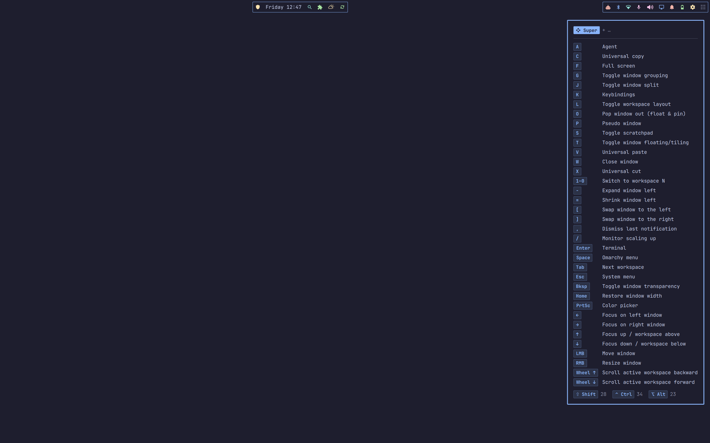

# Keycue

Hold **Super** and, after a short pause, a box lists every key that finishes a
binding from there, with what it does. Add Shift, Ctrl or Alt and the list
follows; the footer shows which modifiers lead to more and how many bindings
sit behind each. Let go, or press a key, and it's gone.



- **Never in the way.** It only opens if you hesitate (400 ms by default), so
  quick combos never flash it. It never takes focus or clicks.
- **Always current.** The list is the one behind Omarchy's SUPER+K cheat sheet,
  re-read on every Hyprland reload, so new bindings show up by themselves.
- **Tidy.** Runs like workspaces 1–10 collapse into one row
  (`1–0  Switch to workspace N`).
- **Looks like Omarchy.** Colours, border, font and rounding follow your theme
  and change with it.
- **Configurable.** 52 settings, edited in a terminal app with a live preview:
  `keycue-config`.

## Requirements

- Omarchy 4 (its shell runs the plugin) with Hyprland 0.56 or newer and the
  Lua config (`~/.config/hypr/hyprland.lua`, Omarchy's default).
- `python3` for `keycue-config`; `xkbcli` (libxkbcommon) to read your keymap;
  `notify-send` for problem notices. All three ship with Omarchy.

No root, no extra packages, and no access to `/dev/input` is needed.

## Install

```bash
omarchy plugin add https://github.com/Reflectionist/omarchy-keycue --enable
```

Hold Super for a moment to see it. Run `keycue-config` (or open
**Keycue Settings** from the app launcher) to change how it looks and
behaves.

## Remove

```bash
omarchy plugin remove io.github.reflectionist.keycue
rm -f ~/.local/bin/keycue-config ~/.local/share/applications/keycue-config.desktop
rm -f ~/.config/omarchy/keycue.jsonc   # your settings, if you don't want to keep them
```

Disabling or removing the plugin also takes its key watcher out of Hyprland at
once.

## What it touches

- **Hyprland, at runtime only.** A small Lua watcher (`watcher.lua`) is loaded
  with `hyprctl eval`, plus a layer rule that skips Hyprland's open animation
  for the box (setting `instantAppear`). No Hyprland config file is edited;
  both are gone when the plugin is disabled or Hyprland restarts.
- **`~/.local/bin/keycue-config`** (a link into the plugin) and
  **`~/.local/share/applications/keycue-config.desktop`**, created on first
  run. Existing files at those paths are never overwritten. Set
  `installCommand` to `false` and both are removed again.
- **`~/.config/omarchy/keycue.jsonc`**, your settings, written only by
  `keycue-config` (or you).

## Privacy: how keys are watched

The watcher runs inside Hyprland, which sees every key anyway. It doesn't
record or forward what you type:

- While no trigger modifier (Super by default) is held, it sends nothing.
- While one is held, it sends the shell only which modifiers are down, that
  *some* other key was pressed (never which one), and that the pointer moved.
  When a trigger goes down it also sends the monitor under the cursor, and
  whether the focused window is fullscreen and its class, for the
  `hideInFullscreen` and `disabledApps` settings.

These go out as custom events on Hyprland's event socket, which other programs
running as you can also read; Hyprland already publishes far more there (every
window title and focus change).

## Settings

Run `keycue-config` for the editor: settings on the left, a live copy of the
box on the right. Every change is saved and applied at once.

| Key | Action |
|---|---|
| `↑` `↓`, `[` `]` | move; jump between sections |
| `←` `→` (with Shift: ×10) | change the value |
| `enter` | edit: type a value, or open the list / map / checkbox editor |
| `x` | reset to the default |
| `tab` | preview another level (Super, Super Shift, …) |
| `p` | show the real box on screen while you edit |
| `e` | open the config file in your editor (`$EDITOR`) |
| `r` | undo everything changed in this session |
| `q` | quit |

The settings live in `~/.config/omarchy/keycue.jsonc`, which lists every
option with a comment explaining it; edit it by hand if you prefer, and the
plugin reloads it on save. Colours take `theme`, a colour name from your
theme's `colors.toml` (`accent`, `red`, `foreground`, …), or `#rrggbb`.

**Behaviour**

| Option | Values | Default | What it does |
|---|---|---|---|
| `delay` | 0–5000 ms | `400` | How long a trigger modifier must be held before the box opens. |
| `triggers` | `super`, `alt`, `ctrl` | `["super"]` | Modifiers that open the box when held on their own; each shows the bindings that start with it. |
| `afterKey` | `hide`, `reopen` | `"hide"` | After a key finishes a combo: stay hidden until the modifiers change, or reopen after the delay if they are still held. |
| `pointerHides` | `true`, `false` | `true` | Moving the pointer while a trigger is held (dragging, resizing, scrolling) counts as finishing a combo. |
| `pointerThreshold` | 1–500 px | `24` | How far the pointer must move to count. |
| `monitor` | `focused`, `cursor`, `all` | `"focused"` | Which monitor shows the box. |
| `hideInFullscreen` | `true`, `false` | `false` | Never open over a fullscreen window (games, video). |
| `disabledApps` | list of window class patterns | `[]` | Window classes (regular expressions, case-insensitive) where the box never opens, e.g. steam_app_.* or ^virt-manager$. |
| `instantAppear` | `true`, `false` | `true` | Skip Hyprland's layer animation for the box and use its own short fade. Applied at runtime; no config file is touched. |
| `notifyOnFailure` | `true`, `false` | `true` | Show a notification with steps to fix it if the key watcher cannot start. |
| `installCommand` | `true`, `false` | `true` | Link keycue-config into ~/.local/bin and add a 'Keycue Settings' launcher entry. Existing files are never overwritten. |

**Content**

| Option | Values | Default | What it does |
|---|---|---|---|
| `hide` | list of patterns | `[]` | Bindings to leave out: regular expressions (case-insensitive) matched against the description and the combo, e.g. 'Universal' or 'SUPER ALT \+ [0-9]'. |
| `rename` | combo → description | `{}` | Replace descriptions: combo as in the SUPER+K cheat sheet (e.g. "SUPER + RETURN") mapped to the text to show. |
| `keyLabels` | key → label | `{}` | Key label overrides: key name (as in the cheat sheet, e.g. RETURN, SPACE, mouse_down) mapped to the label to draw, e.g. "RETURN": "⏎". |
| `modifierStyle` | `glyph-name`, `glyph`, `name` | `"glyph-name"` | How modifiers are drawn in the header and footer. |
| `modifierNames` | modifier → name | `{}` | Rename modifiers, e.g. "super": "Win". Defaults: Super, Shift, Ctrl, Alt. |
| `modifierGlyphs` | modifier → glyph | `{}` | Replace modifier glyphs, e.g. "super": "". Defaults: ❖ ⇧ ⌃ ⌥. |
| `sort` | `key`, `description`, `config` | `"key"` | Order of the rows: by key (letters, digits, symbols, named keys, arrows, mouse), by description, or as listed in your config. |
| `collapseRuns` | `true`, `false` | `true` | Join numbered bindings into one row, e.g. 1–0 Switch to workspace N. |
| `minRun` | 2–10 | `3` | How many numbered bindings in a row it takes to collapse them. |
| `showHeader` | `true`, `false` | `true` | Show the held modifiers (❖ Super + …) at the top. |
| `showFooter` | `true`, `false` | `true` | Show the modifiers that lead to more bindings at the bottom. |
| `footerCount` | `rows`, `reachable`, `none` | `"rows"` | The number beside each footer modifier: rows shown after pressing it, every binding reachable through it, or nothing. |
| `emptyText` | text | `"Nothing bound at this level"` | Shown when no binding finishes at the held modifiers. |

**Layout**

| Option | Values | Default | What it does |
|---|---|---|---|
| `position` | `top-left`, `top`, `top-right`, `left`, `center`, `right`, `bottom-left`, `bottom`, `bottom-right` | `"top-right"` | Where the box sits on the monitor. |
| `offsetX` | -2000–2000 px | `0` | Extra horizontal shift; positive moves right. |
| `offsetY` | -2000–2000 px | `0` | Extra vertical shift; positive moves down. |
| `margin` | -1–500 px | `-1` (auto) | Distance from the screen edges. auto lines the box up with your tiled windows (Hyprland gaps_out). |
| `respectBar` | `true`, `false` | `true` | Keep clear of the bar and other reserved screen space. |
| `maxHeight` | 10–100% | `80` | Tallest the box may get, as a share of the monitor; longer lists flow into more columns. |
| `maxColumns` | 0–8 | `0` (no limit) | Most columns to flow into; once reached, the box grows taller instead. |
| `maxDescriptionWidth` | 60–1200 px | `300` | Longer descriptions are cut off with an ellipsis. |
| `padding` | 0–80 px | `14` | Space between the border and the content. |
| `rowSpacing` | 0–40 px | `4` | Space between rows. |
| `columnSpacing` | 0–120 px | `22` | Space between columns. |
| `keyGap` | 0–60 px | `10` | Space between a key and its description. |
| `scale` | 0.5–3.0× | `1.0` | Sizes everything up or down together. |

**Look**

| Option | Values | Default | What it does |
|---|---|---|---|
| `backgroundOpacity` | -1–100% | `-1` (theme) | Opacity of the background only; text, keys and border stay solid. theme uses the theme's popup background alpha. |
| `backgroundColor` | `theme`, theme colour name, `#rrggbb` | `"theme"` | theme (the popup background), a theme colour name such as background or darker_background, or #rrggbb. |
| `textColor` | `theme`, theme colour name, `#rrggbb` | `"theme"` | Descriptions. theme, a theme colour name such as foreground, or #rrggbb. |
| `mutedColor` | `theme`, theme colour name, `#rrggbb` | `"theme"` | Separators, counts and the + signs. theme is the text colour at 60%. |
| `keyColor` | `theme`, theme colour name, `#rrggbb` | `"theme"` | Keys and held modifiers. theme is the accent colour. |
| `borderColor` | `theme`, theme colour name, `#rrggbb` | `"theme"` | theme follows the popup border (including gradients); otherwise a theme colour name or #rrggbb. |
| `borderWidth` | -1–20 px | `-1` (theme) | Border thickness; 0 removes it. |
| `radius` | -1–60 px | `-1` (Hyprland rounding) | Corner rounding of the box; keys use a smaller share of it. |
| `fontFamily` | text | `""` | Font for descriptions and the header; empty uses the Omarchy font. |
| `fontSize` | 0–48 px | `0` (theme) | Description font size. |
| `keyFontFamily` | text | `""` | Font for keys; empty uses the description font. |
| `keyFontSize` | 0–48 px | `0` (theme) | Key font size. |
| `keyStyle` | `outlined`, `filled`, `plain`, `brackets` | `"outlined"` | How keys are drawn. |
| `animation` | `fade`, `slide`, `none` | `"fade"` | How the box appears. |
| `animationMs` | 0–1000 ms | `90` | Length of the appear animation. |

## Troubleshooting

If the key watcher can't start, Keycue shows one notification saying why and
what to try. `keycue-config` shows the status in its top-right corner. Or ask
the plugin directly:

```bash
omarchy-shell keycue state   # watcher status and reason, bindings, config
```

The usual causes are a Hyprland older than 0.56, or a Hyprland not using the
Lua config. Update with `omarchy update`, then `omarchy restart shell`.

## IPC

Also reachable as `io.github.reflectionist.keycue`:

```bash
omarchy-shell keycue preview 1      # open now, as if Super+Shift were held (SHIFT 1, CTRL 4, ALT 8)
omarchy-shell keycue hide
omarchy-shell keycue state          # JSON status
omarchy-shell keycue level 0        # JSON rows for a level, as keycue-config shows them
omarchy-shell keycue reload         # re-read settings, bindings and keymap
omarchy-shell keycue feed "mods 64" # inject a watcher event (testing)
```

## Development

| File | Role |
|---|---|
| `Service.qml` | The service: installs the watcher, reads settings, bindings and keymap, runs the delay, draws the box. |
| `watcher.lua` | Runs inside Hyprland; reports modifier state as custom events. |
| `KeycueModel.js` | Pure logic: config parsing, keymap modifiers, bindings, levels, collapsing, sorting. |
| `Schema.js` | Every setting with its type, default and description; read by the service, the tests and `keycue-config`. |
| `Box.qml`, `KeyCap.qml` | The box and its keys. |
| `bin/keycue-config` | The settings editor (Python, standard library only). |
| `bin/keycue-link-command` | Adds or removes the command link and launcher entry. |

```bash
node tests/model.test.js          # model, plus the live binding list when available
lua tests/watcher.test.lua        # watcher, against a mock of Hyprland's Lua API
python3 -I tests/tui.test.py      # keycue-config: editors, saving, terminal handling
```

After changing the QML, run `omarchy restart shell` before testing over IPC: a
plugin hot-reload leaves the IPC target bound to the old instance.

## License

MIT, see [LICENSE](LICENSE).
